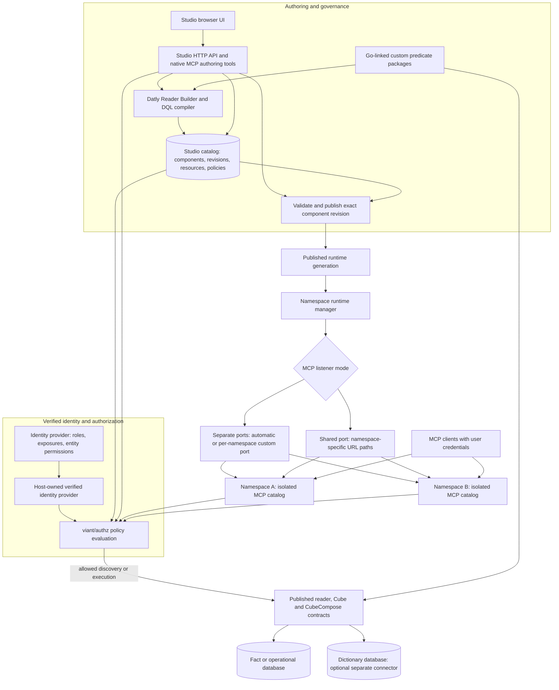

# Data Studio

[](go.mod)
[](https://github.com/viant/datly)

**A visual authoring and operations environment for Datly 1.0 components.**

Data Studio gives SQL-oriented teams a cohesive interface for building,
validating, publishing, and operating typed Datly readers. It uses Datly's
Reader Builder as the authoring authority instead of duplicating DQL parsing or
generation logic in the browser.

Studio starts from a component graph. Authors select a view, edit its SQL in
context, configure typed inputs and columns, inspect relations, test exact draft
versions, and publish the resulting contract through HTTP and MCP. Advanced DQL
remains available without making raw DQL the default editing experience.

> **Status:** active prerelease development against the Datly 1.0 `v1`
> codebase. APIs, storage migrations, and UI extension contracts may change
> before the first stable release.

## Default deployment: one process

Build and start the shared host:

```sh
go build -o studio ./cmd/studio
./studio --config studio.yaml
```

One main configuration supplies the HTTP, admin MCP, and default namespace MCP
listeners; one Studio storage connector; and Datly JWT verification and claims.
The singular `Store` is inline and reuses Datly's connector type and DSN/SCY `Secret` contract. Namespaces,
publications and application data connectors remain database-managed. The host
owns internal service addresses and starts no child binaries.

See [shared configuration](app/hostconfig/README.md) for the minimal example,
secret handling, readiness, shutdown, and current acceptance limits. The default
command owns all services in process. Specialized standalone commands remain
available for explicit separate-service deployments.

## What Studio provides

- Graph-first authoring for root views, subviews, relations, and SQL resources.
- Structured controls for parameters, constants, predicates, fields, casts,
  tags, visibility, cache, warmup, cube, and cube-compose configuration.
- Versioned drafts with validation, exact-version tests, preview, publication,
  rollback, and runtime diagnostics.
- Governed connectors, namespaces, ACLs, and reusable Security predicates.
- Dedicated MCP tool, resource, and skill catalogs with input/output schemas.
- Canonical MCP names with reader, Cube, and Cube Compose tool variants.
- In-process dynamic Datly runtimes for published HTTP and Streamable HTTP MCP
  contracts, with separate-service deployment available explicitly.
- An embeddable Go host boundary and frontend extension SDK for application-
  specific predicate packages and Studio workspaces.

## Architecture



Authoring tools manage Studio's catalog; namespace MCP endpoints expose published
business components. Namespace visibility, component authoring permissions, and
runtime resource policies are separate checks. `viant/authz` evaluates verified
identity facts for catalog discovery and execution; the browser does not decide
access. Cube and cube-compose behavior belongs to the published Datly component
contract. Dictionary enrichment can use another connector.

See [capabilities](docs/capabilities.md), [authorization](docs/authorization.md),
[dynamic MCP](docs/dynamic-mcp.md), [cubes and composition](docs/cubes.md), and
[custom predicates](docs/custom-predicates.md) for boundaries and configuration.


One `studio` process owns the following public listeners. These are example
addresses configured in the quick start below, not separate executables:

| Listener | Example address | Responsibility |
| --- | --- | --- |
| HTTP | `127.0.0.1:8080` | Built UI, authenticated SDK/BFF and operational API |
| Admin MCP | `127.0.0.1:8081` | Native Studio authoring and management tools |
| Namespace MCP | `127.0.0.1:8082` | Shared listener for database-discovered published namespaces |

Internal native HTTP and reload administration use automatically allocated
loopback addresses. They require no additional operator-configured ports or
processes. Vite hot reload on `127.0.0.1:5173` is optional frontend development
infrastructure.

## Prerequisites

- Go `1.25.8`
- Node.js and npm compatible with Vite 6
- SQLite for the self-contained development catalog

Go builds use the published Datly 1.0 and dependency revisions pinned in
`go.mod`; no local Datly replacement is required. Generic authorization types and
Datly policy components come from `github.com/viant/authz` and its `datly` module.

The UI installs Forge from the public commit pinned in `ui/package-lock.json`.
No sibling Forge checkout is required. A Datly checkout is optional for framework work.

## Quick start

Clone the repository:

```sh
git clone https://github.com/viant/datly-studio.git
```

The host creates the canonical Studio tables when its configured store is empty.
An existing store is checked without running upgrade steps. Development sample
data is optional and is not part of application startup.

Build the UI and the single application binary:

```sh
cd ui
npm ci --no-audit --no-fund
npm run build
cd ..
GOWORK=off go build -o studio ./cmd/studio
```

Create `studio.yaml` with one storage definition. Replace the example identity
provider, issuer, and audience with your registered application's values:

```yaml
Endpoint:
  Address: 127.0.0.1:8080
MCP:
  Address: 127.0.0.1:8081
NamespaceMCP:
  Address: 127.0.0.1:8082
Store:
  Driver: sqlite
  DSN: 'file:.data/studio.db?cache=shared'
JWTValidator:
  CertURL: https://idp.example.com/certs
JWTClaims:
  Issuer: https://idp.example.com
  Audience: studio
  RequireSubject: true
StaticRoot: ui/dist
```

For MySQL storage and SCY secret references, see the
[shared configuration example](app/hostconfig/README.md). Application data
connectors and namespace definitions are managed in the database.

Start the application:

```sh
./studio --config studio.yaml
```

The process reports its HTTP, admin MCP and namespace MCP addresses after
startup. Built UI assets are served at [http://127.0.0.1:8080](http://127.0.0.1:8080),
and browser configuration is derived by the host. Browser OAuth login wiring in
the combined launcher and full browser-suite adoption remain outstanding; this
startup example is not a completed interactive sign-in acceptance claim.

## Authoring workflow

1. Configure and test a connector.
2. Create a governed namespace and component.
3. Add inputs and trusted constants.
4. Define the view graph and edit each view's SQL in context.
5. Configure column contracts, relations, predicates, cubes, caches, and MCP
   exposure through structured controls.
6. Validate and test the exact draft version.
7. Publish it to a new runtime generation.
8. Inspect the live HTTP, MCP tool, resource, and skill contracts.

Security predicates are registered by the embedding Go application, managed in
Studio's Security catalog, and assigned to component parameters. Their alias and
column metadata is informational; the linked Go `Compute` method remains the
execution authority.

## MCP and skills

Published components may expose a base reader tool and optional variants:

```text
<mcpToolName>
<mcpToolName>Cube
<mcpToolName>CubeCompose
```

MCP tool names are canonical and currently system-unique. Studio discovers live contracts
through `tools/list`, including input and output schemas. Skills use the native
MCP skills capability when advertised and retain `skills/list` and `skills/get`
tool discovery for hosts without that capability.

With the example configuration, authoring tools are served at:

```text
http://127.0.0.1:8081/mcp
```

Published components use their database-owned namespace ID on the shared listener:

```text
http://127.0.0.1:8082/namespaces/<namespace-id>/mcp
```

There is no global published-component `/mcp` endpoint in the default shared
namespace mode.

## Namespace workspaces

The current namespace is selected in the UI header and scopes component requests.
Namespaces are private by default; owners can assign viewer roles or public
visibility. Resource ACL remains independent of namespace visibility. Connectors
may be shared globally.

The single-process host uses a shared namespace MCP listener configured through
`NamespaceMCP`. Namespace enablement and per-namespace dedicated-port overrides
come from database metadata and are reconciled without restarting the process.
The specialized standalone runtime also retains explicit separate-listener modes;
see [listener modes](docs/dynamic-mcp.md) for that optional deployment.

See [implementation status](docs/namespace-workspaces.md) for remaining namespace
acceptance gates. Data Studio remains independent and reporting-free.

## Extending Studio

Go hosts can register application-owned predicate packages without modifying
Studio internals:

```go
catalog, err := (host.Config{
    PredicatePackages: []predicatecatalog.Package{{
        Alias: "acmeiam",
        Path:  "example.com/acme/iam/authorization",
        Types: []reflect.Type{
            reflect.TypeFor[authorization.CustomerRead](),
        },
    }},
}).PredicateCatalog()
```

Frontend hosts can register additional workspaces through the UI extension SDK:

```jsx
const sdk = createStudioSDK().register(defineStudioExtension({
  id: 'acme.audit',
  label: 'Audit',
  icon: 'history',
  render: ({ api, subject, openComponent }) => (
    <AuditWorkspace api={api} subject={subject} onOpen={openComponent} />
  ),
}));

mountStudio(document.getElementById('root'), { config, sdk });
```

See [UI embedding](ui/embedding.md) for the extension contract.

Embedding hosts can set `runtime/host.Config.NamespaceBuildResolver` to select an
in-process build extension from the namespace ID supplied by the runtime. The
resolver can consult application-owned persisted metadata, so newly created
namespaces do not require operator configuration or a startup list of IDs. Returning
`nil, nil` preserves generic behavior. Existing exact entries in
`NamespaceBuildExtensions` take precedence. Resolution/composition errors close the
candidate build and leave the previous generation available. These are trusted Go
hooks excluded from YAML; they cannot load client-supplied Go code or plugins.

## Development

Run the Go suite:

```sh
GOWORK=off go test ./...
```

Run frontend contract and rendered tests, then build the production bundle:

```sh
cd ui
npm test
npm run build
```

### Build and run e2e

Install [Endly](https://github.com/viant/endly) revision `9ed0e3e271c3d` or newer.
A sibling checkout is optional; this builds the pinned public source:

```sh
endly_src=$(mktemp -d)
git clone https://github.com/viant/endly.git "$endly_src"
git -C "$endly_src" checkout 9ed0e3e271c3db226abe4f050c550e54913c52f7
(cd "$endly_src" && CGO_ENABLED=0 GOWORK=off go build -o endly-bin ./endly)
install -m 0755 "$endly_src/endly-bin" /usr/local/bin/endly
endly -v
```

Run the suite from `e2e`; its build installs the locked UI dependencies:

```sh
cd e2e
endly
```

Plain `endly` first builds and tests the real single-process `studio` binary via
the `unifiedHost` group, then runs the retained fixture-based browser suite:
stop a previous fixture, build the Go fixture and production UI, create a fresh SQLite catalog, seed consumer data
through DSUnit, start Studio, prepare ChromeDriver, run MCP, permission and browser
cases, and stop the fixture. Each invocation chooses a new run directory under
`.data/e2e`, so rerunning does not overwrite an earlier catalog. Python 3 and
local Google Chrome are required for the browser cases; setup downloads a matching
ChromeDriver into the fixture directory.

The unified-host regression checks one application PID with no child services,
all three public listeners, authenticated MCP execution and credential rejection,
derived browser configuration, database-driven namespace enable/disable, and
shutdown. The broader browser fixture still uses its previous custom assembly;
migrating that fixture to the shared host remains outstanding.

Run just the unified-host Endly group:

```sh
endly -r=run -t=unifiedHost
```

To build only:

```sh
endly -t=build
```

See [e2e instructions](e2e/README.md), [coverage plan](e2e/plan.md), and
[verified results](e2e/results.md). The authored suite is runnable; the larger
acceptance matrix still has outstanding cases.

The repository keeps generated Datly components and their DQL sources together.
Changes to canonical schema or DQL contracts must regenerate the affected
components and pass the DQL inventory tests.

## Repository map

| Path | Purpose |
| --- | --- |
| `cmd/studio` | Default single-process application launcher |
| `app/hostconfig` | Shared configuration with one `Store` connector |
| `app/studiohost` | In-process authoring, browser and namespace service lifecycle |
| `cmd/studio-api` | Optional standalone SDK/BFF entry point |
| `cmd/studio-runtime` | Optional standalone published-component runtime |
| `dql/studio` | Datly control-plane DQL sources |
| `runtime` | Dynamic preview, publication, and host behavior |
| `schema` | Canonical relational schema and SQLite fixtures |
| `sdk` | Public Studio operations, DTOs, and transports |
| `studio` | Generated components and application-owned handlers |
| `ui` | React/Forge Studio frontend and extension SDK |
| `e2e` | SQLite-based system and regression fixtures |

## Security

- Production mode uses server-side sessions and verified JWT identity.
- Browser code does not store bearer tokens.
- Dynamic runtime administrative reload/status routes require a dedicated token.
- Published readers enforce owner and ACL permissions independently of catalog
  visibility.
- Development authentication and public runtime configuration are restricted to
  loopback use.

Never commit production DSNs, signing material, session keys, runtime tokens, or
database files. Deployment secrets belong in the host's secret manager or
environment-specific configuration.

## Project documentation

- [Capability overview](docs/capabilities.md)
- [Authorization and identity](docs/authorization.md)
- [Namespace MCP publication](docs/dynamic-mcp.md)
- [Cubes and cube composition](docs/cubes.md)
- [Linked custom predicates and embedding](docs/custom-predicates.md)
- [UI and interaction contract](ui.md)
- [Current architecture and engineering handoff](handoff.md)
- [Studio implementation notes](studio.md)
- [Datly 1.0 documentation](https://github.com/viant/datly/tree/v1/doc)

## License

Licensing files must be added before a public release. Until a repository-level
license is committed, the source is **not licensed for redistribution** merely
because it is visible on GitHub. Datly and each dependency retain their own
licenses.
